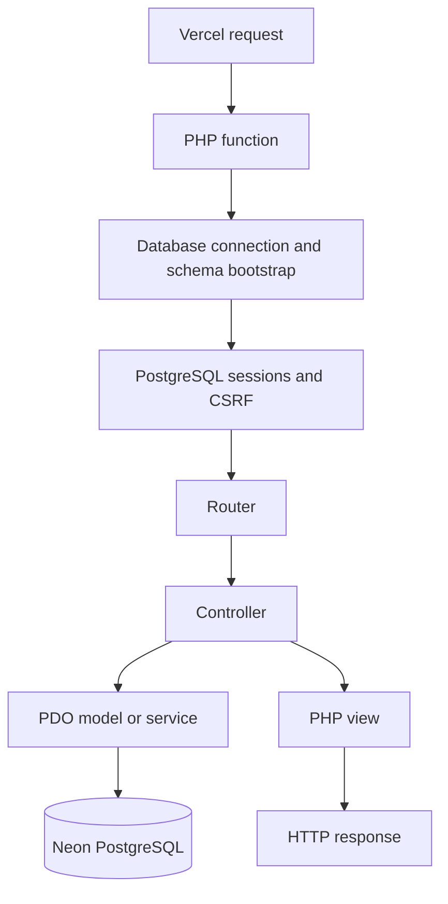

# CoreQA

A native PHP 8.2+ question-and-answer forum for small developer communities, built around PDO and a lightweight MVC-style core.

CoreQA supports question and answer workflows, tags, search, voting, and role-based moderation. It runs locally with SQLite and uses persistent PostgreSQL storage when deployed to Vercel.

## Features

- Account registration, login, logout, and password maintenance
- Questions and answers with ownership-aware editing
- Tags, search, and bounded pagination
- A small Markdown subset with escaped HTML and safe link handling
- Voting with one stored vote per user and answer
- Moderator and administrator actions guarded on the server
- CSRF tokens, durable database-backed sessions, secure session cookies, and request throttling
- Automatic database schema creation on first request
- SQLite for local development and PostgreSQL for Vercel production

## Local quick start

No environment file or service setup is required for local development. Run from the repository root:

```bash
php -S localhost:8080 -t public
```

Open http://localhost:8080 and register an account to start using the forum. Local SQLite storage is initialized automatically. Demo accounts are not created automatically.

## Requirements

- PHP 8.2 or newer
- PDO with the SQLite driver for local development
- PDO with the PostgreSQL driver for Vercel deployments

## Vercel deployment

CoreQA is prepared for a low-configuration Vercel deployment. There are no GitHub deployment secrets, manual CSRF secrets, custom build commands, or hand-written database migration steps.

1. In Vercel, choose **Add New → Project** and import `Aaqibhafeezkhan/CoreQA` from GitHub.
2. Keep the repository root as the project root. The committed `vercel.json` selects the **Other** framework preset and clears the Build Command and Output Directory overrides automatically.
3. Open **Storage → Marketplace** in Vercel, add the Neon Postgres integration, and connect it to the CoreQA project. The integration supplies `DATABASE_URL` to the project; do not copy database credentials into GitHub or commit them.
4. Deploy the project. On its first request, CoreQA creates its PostgreSQL tables and indexes automatically.

The first registered account is deliberately not made an administrator automatically, so a random visitor cannot claim site-owner privileges before you do. After registering your owner account, promote it once in the Neon SQL Editor by replacing the email below and running:

```sql
UPDATE users SET role = 'admin' WHERE email = 'you@example.com';
```

The database connection is the only required one-time external service connection. Once Neon is connected, Vercel's Git integration deploys pull requests as previews and deploys changes from the configured production branch automatically. There is no separate GitHub Actions deployment workflow or Vercel token to maintain.

CoreQA derives its CSRF signing key from the database connection secret when `CSRF_KEY` is not explicitly set. PHP sessions are stored in PostgreSQL so logins continue to work across stateless Vercel function instances. User accounts, questions, answers, votes, tags, and rate-limit records are stored in the persistent database, not in /tmp.

The PHP function uses the community-maintained `vercel-php` runtime. It is not an official Vercel runtime. The runtime version is pinned in `vercel.json` and includes the PDO PostgreSQL driver.

## Architecture

The application uses a small container and router rather than a framework. Controllers coordinate models and services, PDO handles persistence, and PHP views render the response.



See [doc/ARCHITECTURE.md](doc/ARCHITECTURE.md) for the request lifecycle and design details.

## Security model

| Control | Implementation | Verification |
| --- | --- | --- |
| Password hashing and rehash | `app/Models/User.php`, `app/Services/Auth.php` | Reviewed, not covered by tests |
| Session ID regeneration and cookie flags | `app/Services/Auth.php`, `public/index.php` | Reviewed, not covered by tests |
| Durable session storage | `app/Services/DatabaseSessionHandler.php` | Session handler regression tests |
| CSRF token validation and rotation | `app/Services/Csrf.php`, state-changing controllers | CSRF regression tests |
| HTML escaping | `app/Core/Helpers.php`, `app/Services/Markdown.php` | Helper and Markdown regression tests |
| Safe Markdown links and images | `app/Services/Markdown.php` | Markdown regression tests |
| Role and ownership checks | Controllers under `app/Controllers/` | Reviewed, not covered by tests |
| Request throttling | `app/Services/RateLimiter.php` | Reviewed, not covered by tests |
| Response headers and generic errors | `public/index.php` | Reviewed, not covered by tests |
| CSRF signing key | Derived from the database connection secret unless explicitly overridden | Configuration regression tests |

See [SECURITY.md](SECURITY.md) for the supported version, reporting process, threat model, and known limitations.

## Testing

Run the dependency-free checks with:

`bash
php bin/lint.php
php tests/run.php
```

The lint script checks PHP syntax recursively. The regression suite covers Markdown rendering, HTML escaping, CSRF token handling, routing, database URL parsing, SQLite schema initialization, and database-backed session storage. The CI matrix validates PHP 8.2 and 8.5 with both SQLite and PostgreSQL PDO extensions installed, and runs PostgreSQL schema, model, rate-limit, and session tests against a temporary PostgreSQL service. CI does not connect to a live Neon account.

## Local configuration

The default local database is `sqlite:storage/database.sqlite`. You can override it with `DB_DSN`, `DB_USER`, and `DB_PASS`. Set `DATABASE_URL` to use a PostgreSQL connection locally. `CSRF_KEY` is optional; CoreQA derives a stable key from the database connection when it is omitted.

For self-managed MySQL deployments, create the database using [bin/schema.sql](bin/schema.sql) and configure the corresponding PDO DSN.

## Limitations

- The Markdown implementation is a small safe subset, not a complete CommonMark implementation.
- Email delivery is not implemented by the current mail queue worker.
- There is no live Neon account test; CI exercises PostgreSQL schema creation, model queries, sessions, and rate limiting against a temporary PostgreSQL service alongside the SQLite tests.
- The database-backed rate limiter coordinates requests that share the same database, not separate independent deployments.
- PHP execution on Vercel depends on the community-maintained `vercel-php` runtime.

## Roadmap

- Add live PostgreSQL integration tests against a disposable database.
- Add PHPUnit and PHPStan as development-only quality tools.
- Implement email verification and password reset.
- Add accepted answers and notifications.
- Move rate limiting to shared storage for multi-region deployments.

## Contributing

See [CONTRIBUTING.md](CONTRIBUTING.md). Contributions should include focused tests and a DCO sign-off.

## Author

Aaqibhafeez Khan · [GitHub](https://github.com/Aaqibhafeezkhan)

## License

MIT. See [LICENSE](LICENSE).
